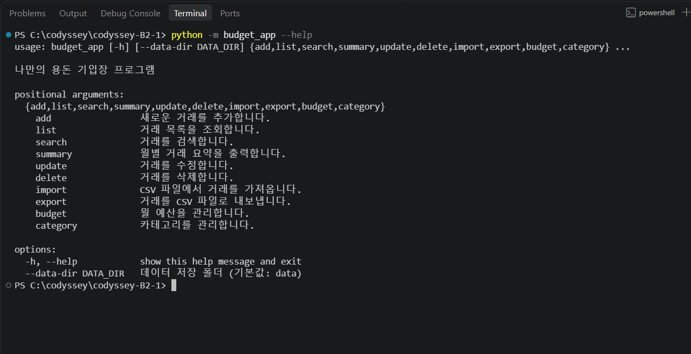
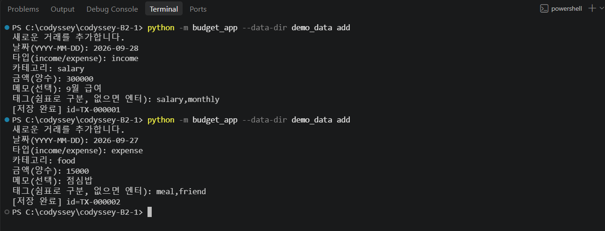
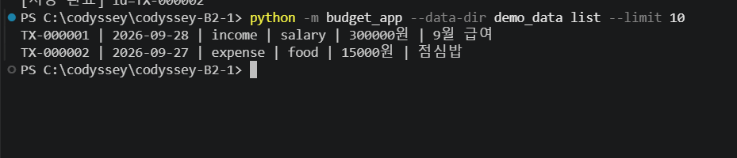
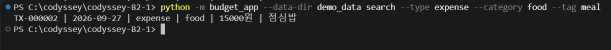
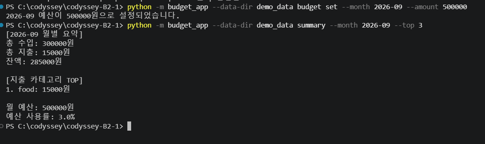
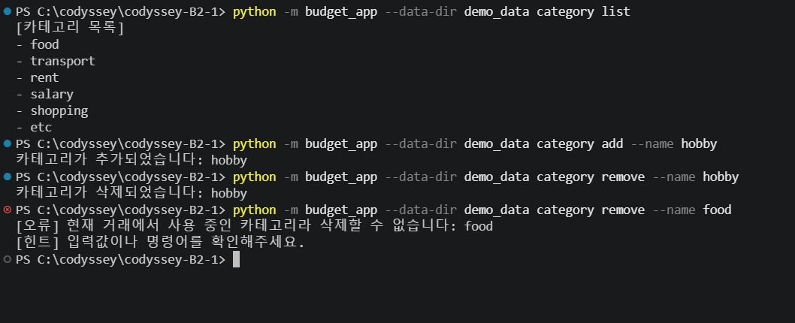
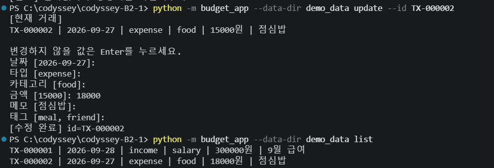
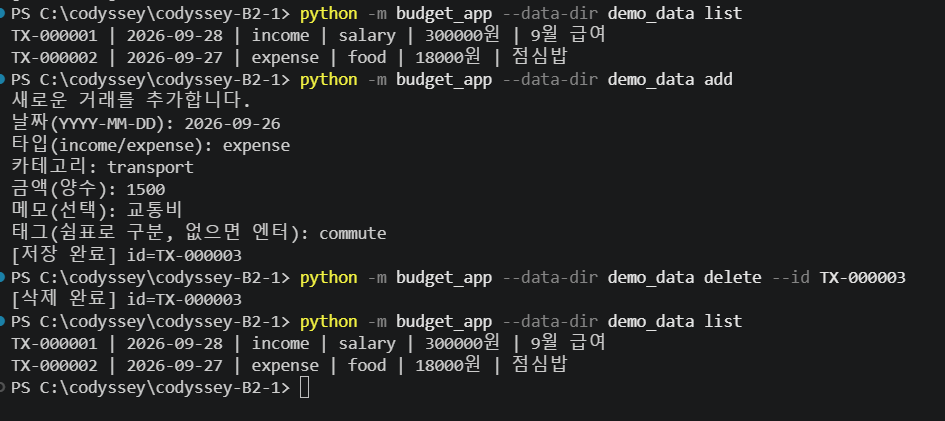
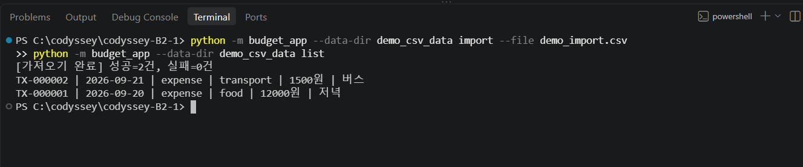

# 💰 나만의 용돈 기입장

Python 파일 입출력을 기반으로 만든 CLI 용돈 기입장입니다.

거래 내역을 JSONL 파일에 저장하며 거래 CRUD, 검색, 월별 요약, 예산 관리,
카테고리 관리, CSV Import/Export 기능을 제공합니다.

---

## 📌 목차

- [1. 주요 기능](#1-주요-기능)
- [2. 실행 방법](#2-실행-방법)
- [3. 기능별 사용법](#3-기능별-사용법)
- [4. 데이터 저장 구조](#4-데이터-저장-구조)
- [5. 프로젝트 구조](#5-프로젝트-구조)
- [6. 주요 구현 포인트](#6-주요-구현-포인트)
- [7. 전체 명령어](#7-전체-명령어)

---

# 1. 주요 기능

| 기능 | 설명 |
| --- | --- |
| 거래 추가 | 수입/지출 거래 등록 |
| 거래 조회 | 최근 거래를 날짜 기준 최신순 조회 |
| 거래 검색 | 날짜, 카테고리, 타입, 메모, 태그 검색 |
| 거래 수정 | ID 기준 대화형 수정 |
| 거래 삭제 | ID 기준 삭제 |
| 월별 요약 | 총 수입, 총 지출, 잔액, 지출 TOP N |
| 예산 관리 | 월별 예산 및 사용률 확인 |
| 카테고리 관리 | 추가, 목록, 삭제 |
| CSV Import | CSV 거래 일괄 등록 |
| CSV Export | 월 또는 기간 기준 CSV 출력 |
| 저장 경로 변경 | `--data-dir` 옵션 지원 |



---

# 2. 실행 방법

Python 3.10 이상에서 실행합니다.

```bash
python -m budget_app
```

도움말:

```bash
python -m budget_app --help
```

기본 데이터 저장 위치:

```text
./data
```

다른 저장 폴더를 사용하려면:

```bash
python -m budget_app --data-dir demo_data list
```

> `--data-dir`은 명령어보다 앞에 작성합니다.

---

# 3. 기능별 사용법

## ➕ 거래 추가

```bash
python -m budget_app add
```

날짜, 타입, 카테고리, 금액, 메모, 태그를 대화형으로 입력합니다.

```text
날짜(YYYY-MM-DD): 2026-09-28
타입(income/expense): income
카테고리: salary
금액(양수): 3000000
메모(선택): 9월 급여
태그(쉼표로 구분, 없으면 엔터): salary,monthly
```

성공 시 고유 ID가 생성됩니다.

```text
[저장 완료] id=TX-000001
```



---

## 📋 거래 목록

```bash
python -m budget_app list
```

출력 개수 지정:

```bash
python -m budget_app list --limit 5
```

날짜를 기준으로 최신 거래부터 출력합니다.



---

## 🔍 거래 검색

```bash
python -m budget_app search --type expense
```

여러 조건을 조합할 수 있습니다.

```bash
python -m budget_app search --type expense --category food --tag meal
```

<details>
<summary><b>지원 검색 옵션 보기</b></summary>

| 옵션 | 설명 |
| --- | --- |
| `--from` | 시작 날짜 |
| `--to` | 종료 날짜 |
| `--category` | 카테고리 |
| `--type` | income / expense |
| `--q` | 메모 검색어 |
| `--tag` | 태그 |

예시:

```bash
python -m budget_app search --from 2026-09-01 --to 2026-09-30
```

```bash
python -m budget_app search --q 점심
```

</details>



---

## 📊 월별 요약 / 예산

월별 요약:

```bash
python -m budget_app summary --month 2026-09
```

지출 카테고리 상위 개수 지정:

```bash
python -m budget_app summary --month 2026-09 --top 5
```

예산 설정:

```bash
python -m budget_app budget set --month 2026-09 --amount 500000
```

요약 결과에는 다음 정보가 포함됩니다.

- 총 수입
- 총 지출
- 잔액
- 지출 카테고리 TOP N
- 월 예산
- 예산 사용률
- 예산 초과 경고



---

## 🗂️ 카테고리 관리

```bash
python -m budget_app category list
```

추가:

```bash
python -m budget_app category add --name hobby
```

삭제:

```bash
python -m budget_app category remove --name hobby
```

거래에서 사용 중인 카테고리는 삭제할 수 없습니다.

```text
[오류] 현재 거래에서 사용 중인 카테고리라 삭제할 수 없습니다: food
```



---

## ✏️ 거래 수정

```bash
python -m budget_app update --id TX-000001
```

기존 값이 표시되며 변경할 값만 입력합니다.

Enter만 누르면 기존 값을 유지합니다.



---

## 🗑️ 거래 삭제

```bash
python -m budget_app delete --id TX-000003
```

성공:

```text
[삭제 완료] id=TX-000003
```

존재하지 않는 ID:

```text
[오류] 해당 거래를 찾을 수 없습니다: TX-999999
```



---

## 📁 CSV Import / Export

CSV Import:

```bash
python -m budget_app import --from demo_import.csv
```

CSV Export:

```bash
python -m budget_app export --out september.csv --month 2026-09
```

기간 기준 Export:

```bash
python -m budget_app export --out range.csv --from 2026-09-01 --to 2026-09-30
```



<details>
<summary><b>CSV 파일 형식 보기</b></summary>

헤더:

```csv
date,type,category,amount,memo,tags
```

필수 컬럼:

- `date`
- `type`
- `category`
- `amount`

선택 컬럼:

- `memo`
- `tags`

예시:

```csv
date,type,category,amount,memo,tags
2026-09-20,expense,food,12000,저녁,"meal,dinner"
2026-09-21,expense,transport,1500,버스,commute
```

</details>

---

# 4. 데이터 저장 구조

데이터는 JSONL 형식으로 영구 저장합니다.

```text
data/
├── transactions.jsonl
├── categories.jsonl
└── budgets.jsonl
```

<details>
<summary><b>저장 데이터 예시 보기</b></summary>

### transactions.jsonl

```json
{"id": "TX-000001", "type": "income", "date": "2026-09-28", "amount": 3000000, "category": "salary", "memo": "9월 급여", "tags": ["salary", "monthly"]}
```

### categories.jsonl

```json
{"name": "food"}
{"name": "transport"}
{"name": "salary"}
```

### budgets.jsonl

```json
{"month": "2026-09", "amount": 500000}
```

</details>

JSONL을 사용하여 데이터를 한 번에 전부 불러오지 않고
한 줄씩 처리할 수 있도록 구현했습니다.

---

# 5. 프로젝트 구조

```text
codyssey-B2-1/
│
├── budget_app/
│   ├── __init__.py
│   ├── __main__.py
│   ├── cli.py
│   ├── decorators.py
│   ├── models.py
│   ├── repositories.py
│   └── services.py
│
├── data/
│   ├── transactions.jsonl
│   ├── categories.jsonl
│   └── budgets.jsonl
│
├── docs/
│   └── images/
│
└── README.md
```

| 파일 | 역할 |
| --- | --- |
| `models.py` | 거래 데이터 모델 |
| `repositories.py` | JSONL 파일 입출력 |
| `services.py` | 검증 및 비즈니스 로직 |
| `cli.py` | CLI 명령어 및 사용자 입력 |
| `decorators.py` | 공통 예외 처리 |
| `__main__.py` | 프로그램 실행 시작점 |

프로그램 구조:

```text
사용자
  ↓
CLI
  ↓
Service
  ↓
Repository
  ↓
JSONL
```

---

# 6. 주요 구현 포인트

<details>
<summary><b>Generator 기반 파일 처리</b></summary>

`transactions.jsonl`을 한 번에 메모리에 올리지 않고
한 줄씩 읽습니다.

```python
def get_all(self) -> Generator[Transaction, None, None]:
    ...
    yield Transaction(**data)
```

`list --limit`에서는 `heapq.nlargest()`를 사용하여
필요한 개수의 최신 거래만 선택합니다.

</details>

<details>
<summary><b>Dataclass와 Type Hint</b></summary>

거래 데이터는 `Transaction` dataclass로 정의했습니다.

```python
@dataclass
class Transaction:
    id: str
    type: str
    date: str
    amount: int
    category: str
    memo: str = ""
    tags: list[str] = field(default_factory=list)
```

함수의 입력값과 반환값에도 Type Hint를 사용했습니다.

```python
def get_by_id(
    self,
    transaction_id: str
) -> Transaction | None:
```

</details>

<details>
<summary><b>Decorator 기반 공통 예외 처리</b></summary>

공통 예외 처리는 `decorators.py`로 분리했습니다.

```python
@handle_errors
def run() -> None:
    main()
```

오류가 발생하면 원인을 출력하고 종료 코드 `1`을 반환합니다.

</details>

<details>
<summary><b>안전한 수정 / 삭제</b></summary>

기존 파일의 중간 내용을 직접 수정하지 않습니다.

```text
원본 파일 읽기
      ↓
임시 파일 작성
      ↓
수정 / 삭제 반영
      ↓
임시 파일로 원본 교체
```

거래 수정, 거래 삭제, 카테고리 삭제, 예산 변경 등에 사용합니다.

</details>

<details>
<summary><b>입력값 검증</b></summary>

다음 항목을 검증합니다.

- 날짜 `YYYY-MM-DD`
- 월 `YYYY-MM`
- 거래 유형 `income / expense`
- 0보다 큰 금액
- 등록된 카테고리
- 존재하는 거래 ID
- CSV 필수 컬럼
- 올바른 날짜 검색 범위

</details>

---

# 7. 전체 명령어

<details>
<summary><b>전체 CLI 명령어 보기</b></summary>

```bash
# 도움말
python -m budget_app --help

# 거래 추가
python -m budget_app add

# 거래 목록
python -m budget_app list
python -m budget_app list --limit 5

# 거래 검색
python -m budget_app search --type expense
python -m budget_app search --category food
python -m budget_app search --tag meal
python -m budget_app search --from 2026-09-01 --to 2026-09-30

# 거래 수정
python -m budget_app update --id TX-000001

# 거래 삭제
python -m budget_app delete --id TX-000001

# 월별 요약
python -m budget_app summary --month 2026-09
python -m budget_app summary --month 2026-09 --top 5

# 예산 설정
python -m budget_app budget set --month 2026-09 --amount 500000

# 카테고리
python -m budget_app category list
python -m budget_app category add --name hobby
python -m budget_app category remove --name hobby

# CSV Import
python -m budget_app import --from demo_import.csv

# CSV Export
python -m budget_app export --out september.csv --month 2026-09
python -m budget_app export --out range.csv --from 2026-09-01 --to 2026-09-30

# 다른 데이터 폴더 사용
python -m budget_app --data-dir test_data list
```

</details>